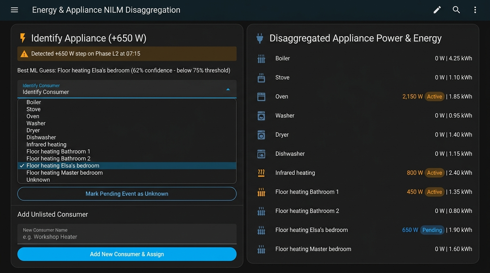
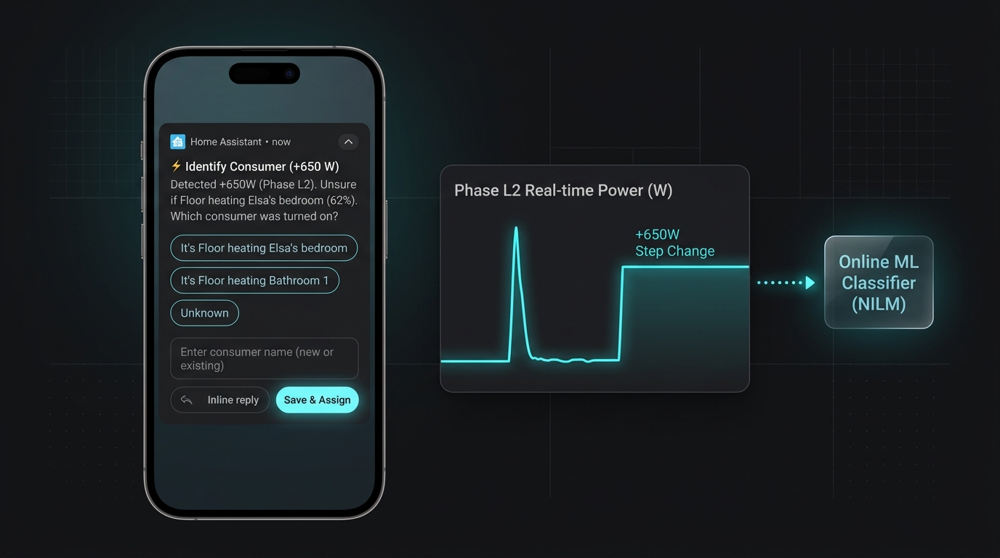

# HomeWizard NILM Appliance Disaggregator (`homewizard_nilm`)

A custom Home Assistant integration that uses **Non-Intrusive Load Monitoring (NILM)** and **Online Machine Learning** to identify individual appliance power signatures from your **HomeWizard P1 Meter** (or Energy Socket) and create individual **Power (`W`)** and **Energy (`kWh`)** sensors for each consumer.

## UI & Notification Previews

### Home Assistant Lovelace Dashboard UI


### Companion App Actionable Notification & Signature Detection


---

## Pre-Configured Consumers

Out of the box, the integration creates live **Power (`W`)** and cumulative **Energy (`kWh`, Energy Dashboard compatible)** sensors for:

1. **Boiler** (`sensor.homewizard_nilm_disaggregator_boiler_power`, `sensor.homewizard_nilm_disaggregator_boiler_energy`)
2. **Stove** (`..._stove_power`, `..._stove_energy`)
3. **Oven** (`..._oven_power`, `..._oven_energy`)
4. **Washer** (`..._washer_power`, `..._washer_energy`)
5. **Dryer** (`..._dryer_power`, `..._dryer_energy`)
6. **Dishwasher** (`..._dishwasher_power`, `..._dishwasher_energy`)
7. **Infrared heating** (`..._infrared_heating_power`, `..._infrared_heating_energy`)
8. **Floor heating Bathroom 1** (`..._floor_heating_bathroom_1_power`, `..._floor_heating_bathroom_1_energy`)
9. **Floor heating Bathroom 2** (`..._floor_heating_bathroom_2_power`, `..._floor_heating_bathroom_2_energy`)
10. **Floor heating Elsa's bedroom** (`..._floor_heating_elsas_bedroom_power`, `..._floor_heating_elsas_bedroom_energy`)
11. **Floor heating Master bedroom** (`..._floor_heating_master_bedroom_power`, `..._floor_heating_master_bedroom_energy`)

Plus any **new consumers** you dynamically add when prompted!

---

## How the Machine Learning & User Prompting Works

1. **Step-Edge & Signature Extraction**:
   - The integration monitors your HomeWizard total active power sensor (and optional 3-phase `L1`, `L2`, `L3` power sensors).
   - When an appliance turns on ($\Delta P \ge \text{min\_power\_delta}$, default `80 W`), it extracts a multi-dimensional feature vector:
     - **Steady-State Power Step ($\Delta P$)** in Watts
     - **Transient Inrush / Peak Overshoot** in Watts
     - **Steady-State Ripple / Standard Deviation** (distinguishes resistive heaters like floor heating/boiler from motor/pulsing loads like washer/dryer/stove)
     - **3-Phase Distribution (`L1`, `L2`, `L3` shares)** (pinpoints which phase a specific bedroom/bathroom floor heating mat or appliance is wired to)
     - **Cyclical Time-of-Day Prior** ($\sin/\cos$ of hour)
2. **Stabilization Window & Transient Spike Filter (New in v1.1.0)**:
   - When a power step is detected, it is placed in a **stabilization staging window** (default `15.0` seconds, configurable from 2 to 120s in integration options).
   - **Spike Rejection**: If the power step collapses back down before the stabilization window elapses (e.g. coffee grinder, microwave door switch, motor inrush surge < 15s), it is rejected as a transient spike and **no prompt or phantom notification is sent**.
   - **True Steady State**: If the load remains sustained throughout the window, the true stabilized power and inrush peak features are extracted, and the exact turn-on timestamp and integrated energy are preserved.
3. **Online Classification & Cold-Start / Uncertainty Notification**:
   - An online Weighted $k$-NN + RBF Kernel Prototype classifier compares the extracted signature against stored labeled signatures in `.storage/homewizard_nilm.ml_store.<entry_id>`.
   - **Cold Start / Low Confidence ($< 75\%$)**:
     - The event is placed in the **Pending Identifications** queue (while its active power and accumulated kWh are tracked in real time so no energy is lost while waiting for your answer).
     - A **Home Assistant Persistent Notification** and **Companion App Mobile Notification** prompt you with:
       - **When it started**: Exact turn-on time (`HH:MM:SS`) and elapsed duration (`15s ago`).
       - **How much power it is drawing**: Stabilized active draw in Watts (`+X W`, plus per-phase breakdown `L1 / L2 / L3`).
       - **How much energy it has consumed so far**: Accumulated energy in both `kWh` and `Wh`.
   - **Your 3 Ways to Answer a Prompt**:
     1. **Select a Known Consumer**: Pick from the dropdown (`select.homewizard_nilm_disaggregator_identify_consumer`) or tap the quick-action button on your phone notification. The ML model immediately learns the signature and credits the event's accumulated energy to that consumer.
     2. **Answer `"Unknown"`**: Select `Unknown` in the dropdown, press the **Mark Pending Event as Unknown** button (`button.homewizard_nilm_disaggregator_mark_pending_event_as_unknown`), or tap `Unknown` on the mobile notification. The event is dismissed without polluting ML training data.
     3. **Add a New Consumer on the Fly**: Type the new consumer's name into `text.homewizard_nilm_disaggregator_new_consumer_name` and press `button.homewizard_nilm_disaggregator_add_new_consumer_assign` (or tap **Other / Add New...** on the mobile notification and type the name). The integration dynamically creates `<New Consumer> Power` (`W`) and `<New Consumer> Energy` (`kWh`) sensors on the spot, trains the ML model with the event signature, and assigns the event's energy to the new consumer!

---

## Installation

1. Copy the `custom_components/homewizard_nilm` folder into your Home Assistant `config/custom_components/` directory:
   ```text
   <config_dir>/
   └── custom_components/
       └── homewizard_nilm/
           ├── __init__.py
           ├── button.py
           ├── config_flow.py
           ├── const.py
           ├── coordinator.py
           ├── manifest.json
           ├── ml_engine.py
           ├── select.py
           ├── sensor.py
           ├── services.yaml
           ├── strings.json
           ├── text.py
           └── translations/
               └── en.json
   ```
2. Restart Home Assistant.
3. Go to **Settings → Devices & Services → Add Integration** and search for **HomeWizard NILM Appliance Disaggregator**.
4. Select your HomeWizard Active Power sensor (e.g. `sensor.p1_meter_active_power`), optional 3-phase power sensors (`L1`, `L2`, `L3`), and optional Mobile App notify service (e.g. `notify.mobile_app_your_phone`).

---

## Rekommenderat Lovelace Dashboard-kort (Svenska, Stilren layout & Senaste först)

Lägg till detta kort i din Home Assistant-översikt (Lovelace). Det är byggt med standard Home Assistant-kort (`conditional`, `markdown`, `entities`) och anpassar sig dynamiskt:
- **Vid 0 väntande identifieringar**: Minimeras automatiskt till ett diskret och grönt statuskort som bekräftar att alla förbrukare är identifierade.
- **Vid 1 eller fler väntande identifieringar**: Expanderas till en elegant prompt som framhäver **uppmätt effekt (+X W)**, **exakt starttid (kl. HH:MM:SS)**, fasfördelning, energiförbrukning hittills samt förslag från maskininlärning.
- **Senaste först**: Visar alltid den senast startade förbrukaren överst i kön.
- **Självbläddrande**: Så fort du bekräftar eller avfärdar en förbrukare visas direkt nästa väntande händelse.
- **Avfärda alla**: Innehåller en knapp för att avfärda alla väntande händelser med ett klick.

```yaml
type: vertical-stack
cards:
  # ---------------------------------------------------------------------------
  # 1. Läge A: När ALLA apparater är identifierade (Rent & Minimerat)
  # ---------------------------------------------------------------------------
  - type: conditional
    conditions:
      - entity: sensor.homewizard_nilm_disaggregator_pending_identifications
        state: "0"
    card:
      type: markdown
      content: >
        <ha-alert alert-type="success">
          <b>✅ Alla förbrukare är identifierade</b><br>
          HomeWizard NILM övervakar aktiv effekt på L1, L2 och L3 i realtid. Inga väntande händelser!
        </ha-alert>

  # ---------------------------------------------------------------------------
  # 2. Läge B: När 1 eller fler förbrukare väntar på identifiering (Kompakt & Stilren)
  # ---------------------------------------------------------------------------
  - type: conditional
    conditions:
      - entity: sensor.homewizard_nilm_disaggregator_pending_identifications
        state_not: "0"
    card:
      type: vertical-stack
      cards:
        - type: markdown
          content: >
            
            
            
            
            ### ⚡ Identifiera förbrukare ({{ pending }} st i kö — senaste först) • 💡 Förslag: <b>{{ guess }}</b> ({{ conf | round(0) }} %)

            {{ state_attr(s, 'current_diagram_svg') or '' }}

        - type: entities
          show_header_toggle: false
          entities:
            - entity: select.homewizard_nilm_disaggregator_identify_consumer
              name: Välj förbrukare
              icon: mdi:check-circle-outline
            - entity: text.homewizard_nilm_disaggregator_new_consumer_name
              name: Ny förbrukare (skriv namn & tryck Enter)
              icon: mdi:plus-circle-outline

  # ---------------------------------------------------------------------------
  # 3. Disaggregated Appliance Power & Energy Monitoring
  # ---------------------------------------------------------------------------
  - type: entities
    title: 🔌 Disaggregated Appliance Power & Energy
    show_header_toggle: false
    entities:
      - sensor.homewizard_nilm_disaggregator_boiler_power
      - sensor.homewizard_nilm_disaggregator_boiler_energy
      - sensor.homewizard_nilm_disaggregator_stove_power
      - sensor.homewizard_nilm_disaggregator_stove_energy
      - sensor.homewizard_nilm_disaggregator_oven_power
      - sensor.homewizard_nilm_disaggregator_oven_energy
      - sensor.homewizard_nilm_disaggregator_washer_power
      - sensor.homewizard_nilm_disaggregator_washer_energy
      - sensor.homewizard_nilm_disaggregator_dryer_power
      - sensor.homewizard_nilm_disaggregator_dryer_energy
      - sensor.homewizard_nilm_disaggregator_dishwasher_power
      - sensor.homewizard_nilm_disaggregator_dishwasher_energy
      - sensor.homewizard_nilm_disaggregator_infrared_heating_power
      - sensor.homewizard_nilm_disaggregator_infrared_heating_energy
      - sensor.homewizard_nilm_disaggregator_floor_heating_bathroom_1_power
      - sensor.homewizard_nilm_disaggregator_floor_heating_bathroom_1_energy
      - sensor.homewizard_nilm_disaggregator_floor_heating_bathroom_2_power
      - sensor.homewizard_nilm_disaggregator_floor_heating_bathroom_2_energy
      - sensor.homewizard_nilm_disaggregator_floor_heating_elsas_bedroom_power
      - sensor.homewizard_nilm_disaggregator_floor_heating_elsas_bedroom_energy
      - sensor.homewizard_nilm_disaggregator_floor_heating_master_bedroom_power
      - sensor.homewizard_nilm_disaggregator_floor_heating_master_bedroom_energy
```

---

## Setting Up Home Assistant Companion App (Mobile Push Notifications)

With the Home Assistant Companion App, you receive actionable push notifications right on your phone or smartwatch as soon as an appliance turns on and stabilizes.

### Step 1: Install the Companion App
1. Download **Home Assistant** from:
   - [Apple App Store (iOS)](https://apps.apple.com/app/home-assistant/id1099568401)
   - [Google Play Store (Android)](https://play.google.com/store/apps/details?id=io.homeassistant.companion.android)
2. Open the app and log in to your Home Assistant instance.
3. Grant **Notification Permissions** when prompted.

### Step 2: Find Your Notify Service Name
1. In Home Assistant web UI, go to **Developer Tools → Actions** (or **Developer Tools → Services** on older versions).
2. In the Action/Service search field, type:
   ```text
   notify.mobile_app_
   ```
3. Look for your phone in the suggestions list. It will look like:
   - `notify.mobile_app_thomas_iphone`
   - `notify.mobile_app_pixel_8`
   - `notify.mobile_app_galaxy_s24`
4. Copy your exact notify service name.

### Step 3: Enter the Notify Service in HomeWizard NILM
1. Go to **Settings → Devices & Services → HomeWizard NILM Disaggregator**.
2. Click **Configure** (or enter it during the initial setup flow).
3. Paste your notify service name into the **Mobile App Notify Service** field (e.g. `notify.mobile_app_thomas_iphone`).
4. Click **Submit**.

### Step 4: How Actionable Notifications Work on Your Phone
When an unidentified appliance starts and stays on for $\ge 15$ seconds:
1. Your phone displays an alert:
   > **⚡ Identify Appliance: +1850W (15s ago)**
   > Started at 14:23:05 UTC (15s ago). Stabilized draw: +1850W (L2), consumed 7.7 Wh. Best guess: Boiler (68%). Which consumer is this?
2. Direct Action Buttons appear:
   - **`It's Boiler`**: One-tap confirmation of the top ML guess.
   - **`It's Washer`**: One-tap confirmation of the runner-up candidate.
   - **`Unknown`**: Mark as unknown so it doesn't skew training data.
   - **`Other / Add New...`**: Opens an inline text input directly on your phone lock screen where you can type any consumer name (e.g. *Sauna* or *Coffee Machine*) and tap Send!
3. If multiple appliances start while you are away, each notification stays in your phone drawer with its own unique tag. Tapping an action resolves that specific appliance without affecting the others.
